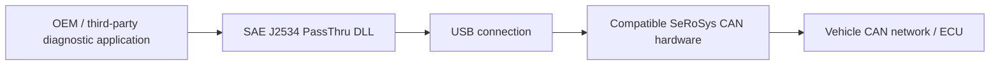

# SLSS J2534 PassThru API

 

 ·  ·  ·  · 

 

## Overview

**SLSS J2534 PassThru API** provides a standardized Windows interface between compatible PC-based automotive diagnostic or ECU flash-programming applications and **SeRoSys CAN interface hardware** connected via USB.
Based on **SAE J2534-1/2 version 04.04**, the solution supplies a PassThru dynamic-link library (DLL) for integration with suitable OEM and third-party applications. Actual application compatibility depends on the protocols, functions and hardware features required by the application.

> **One standardized interface — connecting automotive diagnostic software with SeRoSys CAN hardware.**

## Highlights

| Capability | Description |
|:--|:--|
| **SAE J2534 interface** | PassThru API based on SAE J2534-1/2 v04.04. |
| **Windows integration** | DLL-based interface for compatible Windows applications. |
| **USB hardware connection** | Bridges supported PC applications to SeRoSys CAN interface hardware. |
| **Diagnostics** | Enables integration with compatible ECU diagnostic workflows. |
| **ECU programming** | Provides a J2534 integration path for supported flash-programming applications. |
| **Third-party tools** | Designed for suitable OEM and independent diagnostic applications using J2534. |
| **Documentation** | Installation and user manual available from the SeRoSys download center. |

## How it works

### Standardized diagnostic integration

A compatible application calls the SAE J2534 PassThru interface rather than communicating directly with proprietary hardware commands. The SLSS interface connects the application to supported SeRoSys CAN hardware.

### ECU diagnostics and programming

J2534 is commonly used in automotive diagnostics and ECU reprogramming. Support for any particular OEM application, ECU or vehicle must be verified against its specific requirements and the capabilities of the installed hardware and API version.

## Getting started

1. **Download the installer:** Download from this repository or visit the [SeRoSys download center](https://serosys-tech.com/downloads/) and locate **SLSS J2534-1/2 v04.04 API PassThru**.
2. **Read the manual:** Consult the **SLSS J2534 API PassThru Manual** in the same download center for prerequisites, installation and configuration details.
3. **Connect compatible hardware:** Attach your supported SeRoSys CAN interface to the Windows PC via USB.
4. **Install and configure:** Follow the official installer and manual instructions to register and select the PassThru interface.
5. **Start your application:** Select the SLSS / SeRoSys PassThru device in a compatible diagnostic or programming application, where supported.

**Release reference:** Version **1.0.4** is listed in the official download center. Check the download page for the latest available release.

## Typical applications

| Automotive development | Diagnostics & service | Integration & testing |
|:--|:--|:--|
| ECU communication | Compatible OEM diagnostic applications | J2534 application integration |
| Development and validation | Supported ECU programming workflows | Laboratory and test-bench setups |
| Vehicle network access | Diagnostic troubleshooting | Third-party diagnostic tools |

## Compatibility and scope

The **J2534 API standard** defines a common application interface; it does **not** guarantee that every J2534 application, protocol, vehicle or programming function is supported by a particular hardware/API combination.

Refer to the official manual for the implemented API functions, supported protocols, hardware requirements, configuration details and limitations. Do not assume support for legacy non-CAN protocols or every optional J2534-2 extension without explicit confirmation.

## Safety notice

ECU programming and active vehicle communication can affect vehicle functionality. Use appropriate power stabilization, wiring and safety procedures, and follow the vehicle or application manufacturer's instructions. Avoid using diagnostic or programming functions on public roads or in safety-critical situations.

## Documentation and links

| Resource | Link |
|:--|:--|
| Official product page | [SLSS J2534 PassThru API](https://serosys-tech.com/j2534/) |
| Installer and manual | [SeRoSys Download Center](https://serosys-tech.com/downloads/) |
| Compatible hardware catalog | [SeRoSys Hardware](https://serosys-tech.com/shop) |
| SLSS CANAnalyser | [Product page](https://www.langer-sebastian.de/slss-cananalyser/) |
| Contact | [SLSS_Official@langer-sebastian.de](mailto:SLSS_Official@langer-sebastian.de) |

## Licensing and repository notice

The presence of documentation or downloadable files in this repository does not automatically grant rights to redistribute proprietary software or source code. Refer to the applicable software license and [SeRoSys licensing terms](https://serosys-tech.com/legal-licensing/). This repository does not imply that the PassThru DLL is open source.

## About SLSS

**Sebastian Langer Software Solutions UG (haftungsbeschränkt)** develops engineering software and electronic solutions with a focus on automotive communication, CAN analysis and practical test automation.

The SLSS software ecosystem is developed in cooperation with **[SeRoSys Technology LLC](https://serosys-tech.com/)**, bringing together practical software interfaces and dedicated CAN hardware.

---

**SLSS J2534 PassThru API** · *Because smart solutions matter.*

[Website](https://www.langer-sebastian.de/) · [Product](https://serosys-tech.com/j2534/) · [SeRoSys](https://serosys-tech.com/) · [Contact](mailto:SLSS_Official@langer-sebastian.de)

© 2026 Sebastian Langer Software Solutions UG (haftungsbeschränkt)

