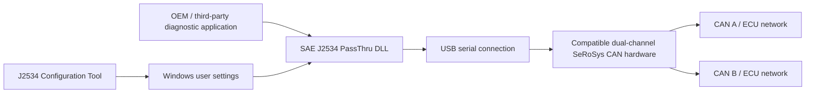

# SLSS J2534 PassThru API

 

 '  '  '  ' 

 

## Overview

**SLSS J2534 PassThru API** provides a standardized Windows interface between compatible PC-based automotive diagnostic or ECU flash-programming applications and **SeRoSys CAN interface hardware** connected via USB.
Based on **SAE J2534-1/2 version 04.04**, the solution supplies a Windows PassThru dynamic-link library (DLL) and a **J2534 Configuration Tool** for integration with suitable OEM and third-party applications. Supported functionality includes CAN communication, CAN FD extensions, ISO-TP transport and dual physical CAN channels on compatible hardware. Actual application compatibility depends on the protocols, functions and hardware features required by the application.

> **One standardized interface — connecting automotive diagnostic software with SeRoSys CAN hardware.**

## Highlights

| Capability | Description |
|:--|:--|
| **SAE J2534 interface** | PassThru API based on SAE J2534-1/2 v04.04. |
| **Windows integration** | DLL-based interface for compatible Windows applications, with standard J2534 registration. |
| **USB hardware connection** | Bridges supported PC applications to SeRoSys CAN interface hardware through a USB serial connection. |
| **Dual CAN channels** | Supports CAN A and CAN B as separate physical channels on compatible two-channel hardware, with multiple logical J2534 connections within one application process. |
| **CAN and CAN FD** | Supports classic CAN and implemented CAN FD extensions, including configurable data-phase communication where supported by the hardware and application. |
| **ISO-TP** | Provides ISO 15765-2 transport handling for supported diagnostic workflows. |
| **Channel assignment** | Supports physical channel selection through protocol mapping and J1962 pin configuration for applicable protocols. |
| **Configuration Tool** | Provides device selection, communication settings, termination configuration and diagnostic logging options. |
| **Registry-based settings** | Stores user configuration in the Windows registry, including an optional dual-channel operating mode. |
| **Diagnostics** | Enables integration with compatible ECU diagnostic workflows. |
| **ECU programming** | Provides a J2534 integration path for supported flash-programming applications. |
| **Third-party tools** | Designed for suitable OEM and independent diagnostic applications using J2534. |
| **Documentation** | Installation and user manual available from the SeRoSys download center. |

## How it works

### Standardized diagnostic integration

A compatible application calls the SAE J2534 PassThru interface rather than communicating directly with proprietary hardware commands. The SLSS DLL manages the USB connection, protocol communication and assignment of logical J2534 channel IDs to the available physical CAN interfaces.

On supported dual-channel hardware, **CAN A and CAN B can operate simultaneously within one application process** when dual-channel mode is enabled and the application opens the corresponding connections. For applicable pin-selectable protocols, the physical bus is selected through the J2534 `J1962_PINS` configuration. For other supported protocols, the DLL assigns the physical channel according to its protocol mapping and available channels.

**Process limitation:** Two separate applications (or two independent instances of the same application) cannot currently share a single USB-connected dongle simultaneously. The USB serial port is opened exclusively; dual-channel mode does not provide cross-process sharing.

### ECU diagnostics and programming

J2534 is commonly used in automotive diagnostics and ECU reprogramming. The implementation includes classic CAN, supported CAN FD extensions and ISO-TP-based diagnostic communication. Support for any particular OEM application, ECU or vehicle must be verified against its specific requirements and the capabilities of the installed hardware and API version.

The **J2534 Configuration Tool** allows the user to select the connected device and configure operating settings such as CAN termination, logging and dual-channel mode. Runtime preferences are stored under `HKEY_CURRENT_USER\Software\SLSS_J2534_PassThru`; the `device_multi_channel_mode` DWORD controls whether simultaneous use of both physical CAN channels is enabled (`0` = legacy mode, `1` = dual-channel mode). This setting does **not** create two separate device entries in a diagnostic application.

## Getting started

1. **Download the installer:** Download from this repository or visit the [SeRoSys download center](https://serosys-tech.com/downloads/) and locate **SLSS J2534-1/2 v04.04 API PassThru**.
2. **Read the manual:** Consult the **SLSS J2534 API PassThru Manual** in the same download center for prerequisites, installation and configuration details.
3. **Connect compatible hardware:** Attach your supported SeRoSys CAN interface to the Windows PC via USB.
4. **Install and configure:** Run the installer. The **J2534 Configuration Tool** launches during installation; select your connected device, configure the required settings, save the configuration and close the tool to continue.
5. **Enable dual-channel operation if needed:** In the Configuration Tool, enable the multi-channel option for simultaneous CAN A / CAN B use within a compatible application.
6. **Start your application:** Select the SLSS / SeRoSys PassThru device in a compatible diagnostic or programming application, where supported. The application must itself support the required J2534 protocols and channel connections.

**Release reference:** Version **1.0.4** is listed in the official download center. Check the download page for the latest available release.

## Typical applications

| Automotive development | Diagnostics & service | Integration & testing |
|:--|:--|:--|
| ECU communication | Compatible OEM diagnostic applications | J2534 application integration |
| Development and validation | Supported ECU programming workflows | Laboratory and test-bench setups |
| Vehicle network access | Diagnostic troubleshooting | Third-party diagnostic tools |
| Dual-bus CAN development | ISO-TP diagnostics | CAN FD integration and validation |

## Compatibility and scope

The **J2534 API standard** defines a common application interface; it does **not** guarantee that every J2534 application, protocol, vehicle or programming function is supported by a particular hardware/API combination.

The API registers as **one J2534 PassThru device**, not as separate Windows J2534 entries for CAN A and CAN B. A host application must open and manage the required logical channels. Channel selection and the availability of CAN FD or ISO-TP functions depend on the chosen protocol, pin configuration, device hardware and host application.

Dual-channel support is **within one host process**; simultaneous access to the same USB dongle from two independent host processes is not supported. The configuration registry setting does not change this limitation.

Refer to the official manual for the implemented API functions, supported protocols, hardware requirements, configuration details and limitations. Do not assume support for legacy non-CAN protocols or every optional J2534-2 extension without explicit confirmation.

## Safety notice

ECU programming and active vehicle communication can affect vehicle functionality. Use appropriate power stabilization, wiring and safety procedures, and follow the vehicle or application manufacturer's instructions. Avoid using diagnostic or programming functions on public roads or in safety-critical situations.

## Documentation and links

| Resource | Link |
|:--|:--|
| Official product page | [SLSS J2534 PassThru API](https://serosys-tech.com/j2534/) |
| Installer and manual | [SeRoSys Download Center](https://serosys-tech.com/downloads/) |
| Compatible hardware catalog | [SeRoSys Hardware](https://serosys-tech.com/shop) |
| SLSS CANAnalyser | [Product page](https://www.langer-sebastian.de/slss-cananalyser/) |
| Contact | [SLSS_Official@langer-sebastian.de](mailto:SLSS_Official@langer-sebastian.de) |

## Licensing and repository notice

The presence of documentation or downloadable files in this repository does not automatically grant rights to redistribute proprietary software or source code. Refer to the applicable software license and [SeRoSys licensing terms](https://serosys-tech.com/legal-licensing/). This repository does not imply that the PassThru DLL is open source.

## About SLSS

**Sebastian Langer Software Solutions UG (haftungsbeschränkt)** develops engineering software and electronic solutions with a focus on automotive communication, CAN analysis and practical test automation.

The SLSS software ecosystem is developed in cooperation with **[SeRoSys Technology LLC](https://serosys-tech.com/)**, bringing together practical software interfaces and dedicated CAN hardware.

---

**SLSS J2534 PassThru API** · *Because smart solutions matter.*

[Website](https://www.langer-sebastian.de/) · [Product](https://serosys-tech.com/j2534/) · [SeRoSys](https://serosys-tech.com/) · [Contact](mailto:SLSS_Official@langer-sebastian.de)

© 2026 Sebastian Langer Software Solutions UG (haftungsbeschränkt)

